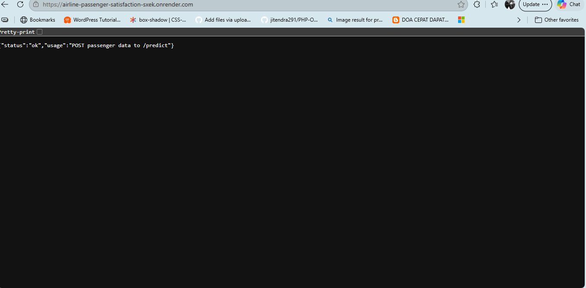
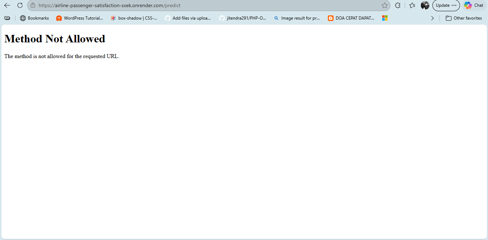
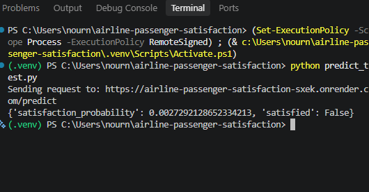

# Airline Passenger Satisfaction Prediction

Machine learning project for the [ML Zoomcamp](https://github.com/DataTalksClub/machine-learning-zoomcamp) midterm (DataTalks.Club).


## Problem description

Many airlines collect passenger surveys to understand how passengers experienced a flight, but it is hard to tell which parts of the experience matter most for overall satisfaction. This project builds a binary classifier that predicts whether a passenger will be **satisfied** or **neutral/dissatisfied**, based on the passenger's profile, trip details, flight delays and ratings of services such as online boarding, wifi and seat comfort. Beyond the predictions, the model's feature importances show which factors it relies on most, so an airline can see where improvements, such as a better online boarding process, are most likely to matter.

How it could be used: an airline could use the model's feature importances to see which parts of the experience, such as online boarding or inflight wifi, are most associated with passenger satisfaction, and so decide where improvements matter most. The model can also estimate overall satisfaction from a passenger's profile, trip details and service ratings, for example when a survey was only partly completed. It is a learning project and a decision-support tool, not a replacement for real feedback.

## Dataset

Source: [Airline Passenger Satisfaction (Kaggle)](https://www.kaggle.com/datasets/teejmahal20/airline-passenger-satisfaction), modified from [John D's customer satisfaction dataset](https://www.kaggle.com/johndddddd/customer-satisfaction). Neither Kaggle page states clear license terms. The data is used here for educational purposes only, and full credit goes to the original authors.

Files: `data/train.csv` (103,904 rows) and `data/test.csv`, both committed in this repo.

- Target: `satisfaction` (satisfied / neutral or dissatisfied).
- Features (22): gender, customer type, age, type of travel, class, flight distance, 14 service ratings (1-5, where 0 means "not applicable"), and departure and arrival delay in minutes.

## Approach

1. **Data cleaning:** dropped the index and id columns, standardized column names and text values, and filled 310 missing arrival delays with the departure delay (the two correlate at 0.96).
2. **EDA:** target balance, distributions, satisfaction by customer type, travel type and class, correlations with the target, and multicollinearity (only two feature pairs above 0.7).
3. **Models:** logistic regression, random forest and XGBoost, each tuned on a validation set.
4. **Final model:** XGBoost (`max_depth=7`, `learning_rate=0.3`, 100 trees), trained on all of `train.csv`.

### Results

| Model                       | Validation AUC |
| --------------------------- | -------------- |
| Logistic regression (tuned) | 0.927          |
| Random forest (tuned)       | 0.994          |
| XGBoost (tuned)             | 0.995          |

The most important features for the model are online boarding, type of travel, inflight wifi, customer type and class. These show what the model relies on, not what causes satisfaction.

### Feature importance

The five most important features for the final XGBoost model are:

| Feature                           | Importance |
| --------------------------------- | ---------- |
| online_boarding                   | 0.42       |
| type_of_travel = business_travel  | 0.15       |
| inflight_wifi_service             | 0.12       |
| customer_type = disloyal_customer | 0.06       |
| class = business                  | 0.05       |

Together, the top five account for about 79% of the model's total importance, and online boarding alone for 42%. These features also showed the largest differences in satisfaction in the EDA. Importance shows what the model relies on for its predictions, not what causes satisfaction.

## Repository structure

| File               | Purpose                                            |
| ------------------ | -------------------------------------------------- |
| `notebook.ipynb`   | Data cleaning, EDA, model selection and tuning     |
| `train.py`         | Trains the final model and saves it to `model.bin` |
| `predict.py`       | Flask web service that serves predictions          |
| `predict_test.py`  | Sends an example request to the service            |
| `model.bin`        | Saved DictVectorizer and XGBoost model             |
| `Dockerfile`       | Container for the web service                      |
| `requirements.txt` | Python dependencies                                |
| `data/`            | Training and test data                             |

## How to run

### 1. Set up the environment

```bash
git clone <repo-url>
cd <repo-folder>
python -m venv .venv
source .venv/Scripts/activate    # Windows (Git Bash); on macOS/Linux: source .venv/bin/activate
pip install -r requirements.txt
```

Python 3.12 was used. To run the notebook, also install `jupyter`, `matplotlib` and `seaborn`.

### 2. Train the model

```bash
python train.py
```

This prints the test AUC (about 0.995) and saves `model.bin`.

### 3. Run the service locally

```bash
python predict.py
```

In a second terminal:

```bash
python predict_test.py
```

### 4. Run with Docker

```bash
docker build -t airline-satisfaction .
docker run -it --rm -p 9696:9696 airline-satisfaction
```

Then run `python predict_test.py` from another terminal.

## Example

Request (POST to `http://localhost:9696/predict`): a JSON object with the 22 features, for example:

```json
{
  "gender": "female",
  "customer_type": "loyal_customer",
  "age": 42,
  "type_of_travel": "personal_travel",
  "class": "eco",
  "flight_distance": 800,
  "inflight_wifi_service": 2,
  "departure_arrival_time_convenient": 3,
  "ease_of_online_booking": 3,
  "gate_location": 3,
  "food_and_drink": 3,
  "online_boarding": 3,
  "seat_comfort": 3,
  "inflight_entertainment": 3,
  "on_board_service": 3,
  "leg_room_service": 3,
  "baggage_handling": 3,
  "checkin_service": 3,
  "inflight_service": 3,
  "cleanliness": 3,
  "departure_delay_in_minutes": 15,
  "arrival_delay_in_minutes": 20
}
```

Response:

```json
{ "satisfaction_probability": 0.0027, "satisfied": false }
```

Text values must be lowercase with underscores (for example `business_travel`), and all 22 fields must be present, because a missing or misspelled field does not raise an error.

## Cloud deployment

The service is deployed on [Render](https://render.com) as a Docker web service (free tier):

**Status page:** https://airline-passenger-satisfaction-sxek.onrender.com/
**Prediction endpoint:** https://airline-passenger-satisfaction-sxek.onrender.com/predict (POST only; opening it in a browser shows "Method Not Allowed")git status
Deployed by connecting this GitHub repository to a Render Web Service with the language set to Docker. Render builds the `Dockerfile` and sets the `PORT` variable, which the container reads.

To test it, set `url` in `predict_test.py` to the address above and run `python predict_test.py`.





Note: the free tier sleeps after about 15 minutes without traffic, so the first request may take up to a minute.
